# multidbs

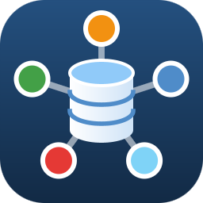

*1 gestor, n motores.*

Cliente SQL de escritorio para MySQL, inspirado en SQLyog: se replican solo las funciones que se usan a diario y se
mejoran las que sus usuarios critican. Java 25 + JavaFX 25, sin framework, con la arquitectura DDD de
`prj-task-cruds/task-java`.

## 1 - Requisitos

1. JDK 25 y Maven 3.9 en el `PATH`.
2. GNU make (Git Bash en Windows o WSL).

## 2 - Uso

| # | Comando | Qué hace |
|---|---|---|
| 1 | `make help` | lista de comandos |
| 2 | `make run` | compila y abre la app |
| 3 | `make test` | tests (con su propia BD en `target/test-home`) |
| 4 | `make build` | compila y copia las dependencias a `target/lib` |

Los datos del usuario (conexiones guardadas) viven en `~/.javayog/javayog.sqlite`; la variable `JAVAYOG_HOME` cambia
esa carpeta.

## 3 - Estructura

```
src/
├── cmd/desktop/Main.java          punto de entrada (bin/desktop)
├── core/                          arranque (migraciones + ventana) y Global (getenv, __)
└── modules/
    ├── shared/                    Primitives, excepciones, BD local, repositorio base MySQL, controller base, estilos
    ├── devops/                    migraciones de la BD local
    ├── connections/               gestor de conexiones + sesiones abiertas contra el MySQL destino
    ├── explorer/                  arbol de objetos (BD -> tablas, vistas, rutinas, triggers -> columnas)
    ├── query/                     editor SQL: troceo en sentencias, ejecutar y cancelar, resultado
    ├── dbcopy/                    copiar BD o tablas a otro servidor o BD (MySQL/MariaDB)
    └── workspace/                 ventana principal y pestaña de conexion (une arbol y editores)
        cada modulo:
        ├── application/<caso>/    <Caso>Dto + <Caso>Service (getInstance + invoke) + <Caso>ResultDto
        ├── domain/                entities, enums, exceptions, services
        └── infrastructure/        controllers (JavaFX), repositories (Reader/Writer), components, views (FXML)
tests/                             testcase/ + tests por modulo, con mothers
```

## 4 - Funciones

1. **0.1.0** — gestor de conexiones MySQL: nueva, editar, probar, clonar y borrar; color por conexión y marca de
   producción.
2. **0.2.0** — abrir una conexión (doble clic, Enter o **Abrir**) en su pestaña, coloreada con el color de la conexión:
    1. **Árbol de objetos**: BD → tablas, vistas, procedimientos, funciones y triggers → columnas, cargado al
       desplegar y en segundo plano; filtro de BD, Refrescar (F5) y menú contextual (ver datos, SHOW CREATE,
       insertar o copiar el nombre). Seleccionar un nodo hace activa su BD.
    2. **Editor SQL con pestañas**: resaltado y números de línea; Ctrl+Enter (o F9) ejecuta la sentencia del cursor (o
       lo seleccionado), Ctrl+F9 todas; Ctrl+T pestaña nueva, Ctrl+W cerrarla, doble clic en su nombre para
       renombrarla. Entiende comillas, comentarios y `DELIMITER`.
    3. **Resultado**: en segundo plano con **Cancelar** (KILL QUERY); una rejilla por result set (NULL distinto de
       vacío, Ctrl+C copia las celdas), el mismo resultado en texto plano y la pestaña Mensajes (filas, tiempo,
       errores con su código). "Máx. filas" limita lo que se lee.
3. **0.3.0** — en una conexión de producción, `UPDATE`/`DELETE` sin `WHERE`, `DROP` y `TRUNCATE` piden confirmación
   antes de ejecutarse (el botón por defecto es Cancelar).
4. **0.4.0** — pestaña **Info** de una tabla o vista (menú del árbol): engine, filas, tamaño de datos e índices,
   índices agrupados y el DDL.
5. **0.5.0** — rejilla: buscar en todas las columnas a la vez y ocultar/mostrar columnas (menú **+** de la cabecera);
   la búsqueda y las columnas ocultas se conservan al volver a ejecutar en la misma pestaña.
6. **0.6.0** — pestaña **Datos** de una tabla o vista (F11 o menú del árbol): filtro `WHERE`, `ORDER BY` y límite,
   que se conservan al refrescar (Enter o F5).
7. **0.7.0** — doble clic en una celda abre su valor entero en un visor; si es JSON, formateado (se puede ver tal cual).
8. **0.8.0** — **historial** de queries (Ctrl+H): cada ejecución con su conexión, BD, tiempo, filas y si falló; se busca
   en el SQL y se pega en el editor. Guarda las últimas 5.000.
9. **0.9.0** — **tema oscuro** completo (editor, rejillas y diálogos incluidos): menú **Ver → Tema oscuro**; se recuerda.
10. **0.9.1** — fix: la BD activa sigue a un `USE` escrito en el editor. `make test-mysql` pasa además 10 tests contra un
    MySQL 8.4 desechable en Docker (`make mysql-down` lo borra).
11. **0.10.0** — **editar en la rejilla** de la pestaña Datos (tablas con clave primaria): editar celdas, poner NULL,
    añadir, duplicar y borrar filas; se guarda todo junto (Ctrl+S) en una transacción.
12. **0.11.0** — **autocompletado** (Ctrl+Space o al escribir `.`): entiende alias (`FROM customers c` → `c.` da sus
    columnas) y busca por contiene y fuzzy (`cstm` → `customers`), no solo por prefijo.
13. **0.12.0** — **túnel SSH** por conexión (password o clave privada); la clave del servidor se acepta la primera vez
    y se vigila después (`~/.javayog/known_hosts`).
14. **0.13.0** — las **contraseñas** guardadas (BD y SSH) ya no están en claro: DPAPI en Windows (atadas a tu usuario),
    AES con clave local en Linux/Mac. Las antiguas se cifran solas al arrancar.
15. **0.14.0** — **iconos** en toda la app, con el papel de los de SQLyog pero dibujo propio (vectoriales, sin
    imágenes, se ven igual en tema claro y oscuro): botones, árbol de objetos (BD, carpetas, tabla, vista, rutina,
    trigger, columna y llave en la PK), pestañas, menús y menús contextuales. Catálogo en
    `modules/shared/infrastructure/components/icons` (`<AppIcon name="execute"/>` en FXML).

    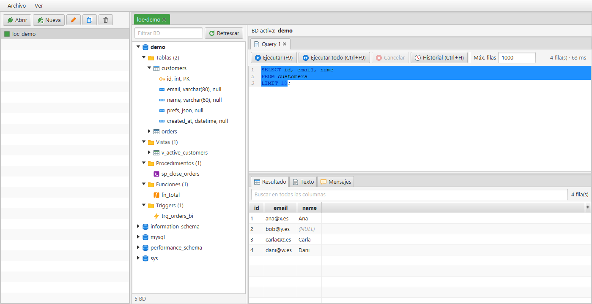

    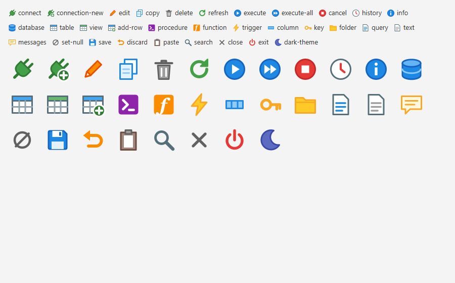
16. **0.15.0** — el diálogo de conexión va por **pestañas** (MySQL, SSH y HTTP, como SQLyog) y entra el **túnel HTTP**
    (feature 13) contra el PHP de `prj-yog` (protocolo de SQLyog 13.21): la URL lleva el token de acceso y se guarda
    cifrada. Árbol, editor, Datos, autocompletado, Cancelar e historial funcionan igual por el túnel; guardar la rejilla
    va en un solo lote atómico (`START TRANSACTION … COMMIT`, con comprobación de que cada fila sigue ahí). SSH y HTTP
    son excluyentes. `make test-mysql` levanta también el túnel PHP en Docker (busca el código en
    `../prj-yog/backend_web`; otra ruta con `YOG_TUNNEL_DIR=...`).

    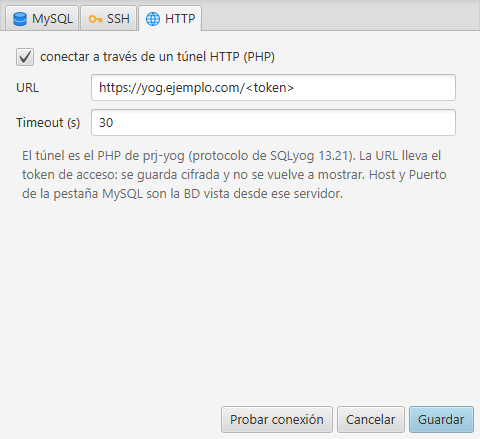
17. **0.16.0** — **PostgreSQL** (motor `pgsql`): directo, por túnel SSH y por el túnel PHP (`.../pg`). En el árbol, cada
    "BD" es un **esquema** de la BD conectada (por defecto `postgres`) y la BD activa es el `search_path`. Info arma el DDL
    desde `pg_catalog` (columnas, restricciones e índices); "Ver definición" saca funciones, procedimientos, triggers y
    vistas. El editor entiende los cuerpos `$$ … $$`; la rejilla editable guarda en transacción. El diálogo de conexión
    tiene un desplegable **Motor** y la lista marca las conexiones que no son MySQL (`PG`). Los errores sin número
    muestran su SQLSTATE (`42P01`). Por dentro: `SqlDialect`, un repositorio del árbol por motor y el ejecutor JDBC
    genérico.

    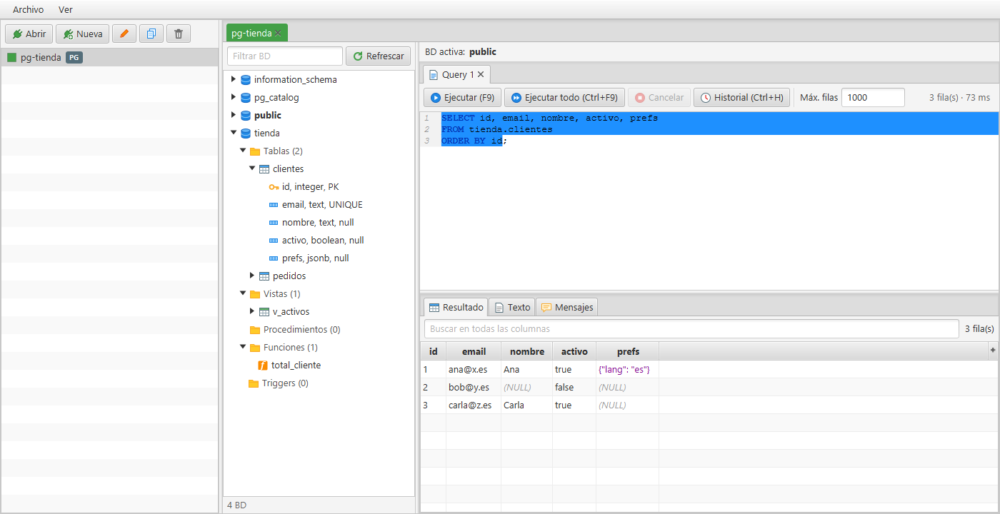
18. **0.17.0** — **SQLite** (motor `sqlite`): un fichero local (con selector; si no existe, error en vez de crearlo vacío) o,
    por el túnel PHP (`.../sqlite`), un fichero de su lista de BDs por su clave, con `YOG_SQLITE_PASSWORD` como password.
    El árbol sale de `sqlite_master` y de las funciones `pragma_*` (main y BDs adjuntas; la INTEGER PRIMARY KEY como
    `auto_increment`); Info enseña el DDL guardado y las filas contadas. El editor no corta los `CREATE TRIGGER … END;`.
    Los tests de SQLite no necesitan Docker: corren también con `make test`.

    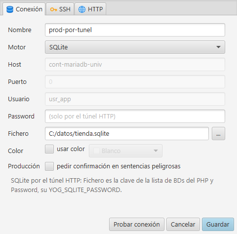
19. **0.18.0** — **Redis** (motor `redis`), con su propia pestaña. A la izquierda, las claves por `SCAN` con patrón y por
    tandas (nunca `KEYS`), agrupadas por los `:` de su nombre, con icono por tipo y TTL en el tooltip. A la derecha, el
    valor de la clave elegida (string, hash, list, set, zset y stream; los binarios en hexadecimal), editable según su
    tipo, con TTL, renombrar y borrar; y una **consola** como `redis-cli` (comillas, escapes `\xHH`, historial con ↑ ↓,
    respuesta con el mismo formato). En producción, borrar, renombrar y los comandos peligrosos (`FLUSHDB`, `DEL`,
    `CONFIG SET`...) piden confirmación. Por túnel SSH sí; el túnel PHP no habla Redis. La "BD" es el índice (0, 1...).

    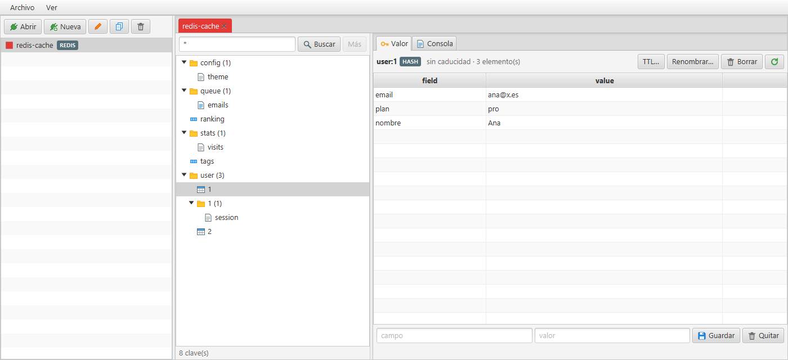
20. **0.19.0** — **MongoDB** (motor `mongodb`), con su propia pestaña. A la izquierda, las BDs y sus colecciones (con su
    número de documentos); a la derecha, los documentos de la colección con **filtro, orden, salto y límite** en JSON
    (como en mongosh), una tabla con un campo por columna y el **JSON del documento** elegido para editarlo, guardarlo,
    insertarlo como nuevo o borrarlo (con la sintaxis de mongosh: `ObjectId(...)`, `ISODate(...)`, `NumberLong(...)`,
    así los tipos no se pierden al guardar). La **consola** entiende un subconjunto de mongosh: `show dbs`,
    `show collections`, `use x`, `db.coll.find(...).sort(...).limit(...)`, `findOne`, `countDocuments`, `distinct`,
    `aggregate`, `insertOne/Many`, `updateOne/Many`, `replaceOne`, `deleteOne/Many`, `getIndexes`, `createIndex`,
    `dropIndex`, `drop`, `db.runCommand({...})` y `db.dropDatabase()`. En producción, lo destructivo pide confirmación.
    El Host admite una cadena `mongodb+srv://...` (sin credenciales: van en Usuario y Password, cifrados). Por SSH sí.

    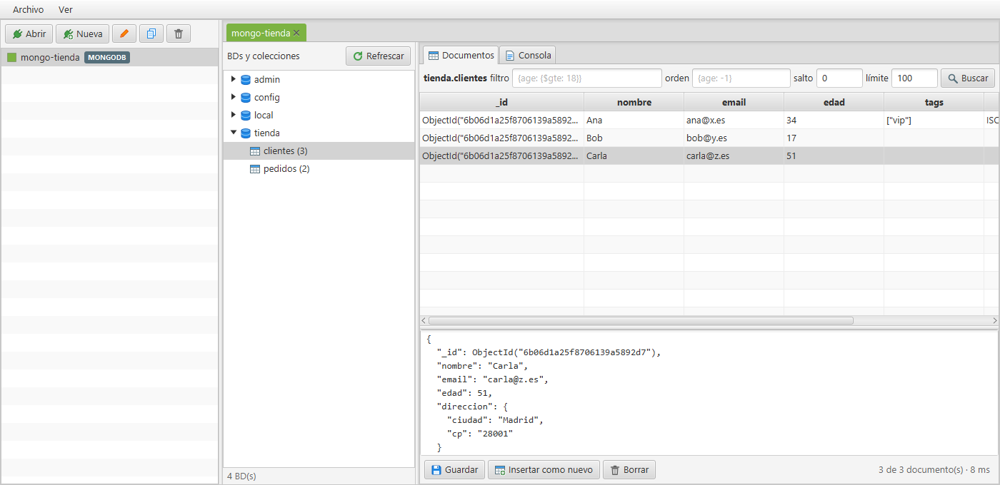
21. **0.20.0** — **filtro en dos niveles** en el árbol: "Filtrar BD" deja solo las bases de datos cuyo nombre contiene el
    texto y "Filtrar tablas, vistas, rutinas..." filtra los objetos de las BD ya desplegadas (abre las carpetas con
    coincidencias, oculta las vacías y el contador pasa a `visibles/total`). Las **BD se colorean por entorno** según una
    palabra de su nombre separada por `-`, `_` o `.`: `prod`/`production` en **rojo**, `dev`/`develop` en **naranja** y
    `loc`/`local` en **verde** (`prod-shop`, `shop_dev`, `loc.crm`; `products` o `devices` no cuentan).

    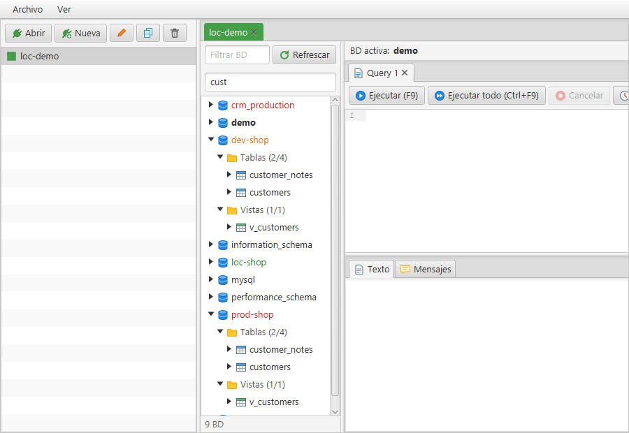
22. **0.21.0** — el árbol de objetos cuelga **debajo de su conexión** en el panel de la izquierda (como el Object
    Browser de SQLyog): al abrir una conexión SQL, sus BD, carpetas, tablas y columnas aparecen bajo ella y la pestaña de
    la derecha queda solo con el editor. Una pestaña por conexión (abrirla otra vez la pone delante); elegir un nodo de
    una conexión pone su pestaña delante y hace activa su BD. Los filtros de BD y de tablas y el botón Refrescar (F5)
    pasan arriba del panel y valen para todas las conexiones abiertas. Borrar solo con la conexión cerrada. Redis y
    MongoDB siguen con su navegador dentro de la pestaña.

    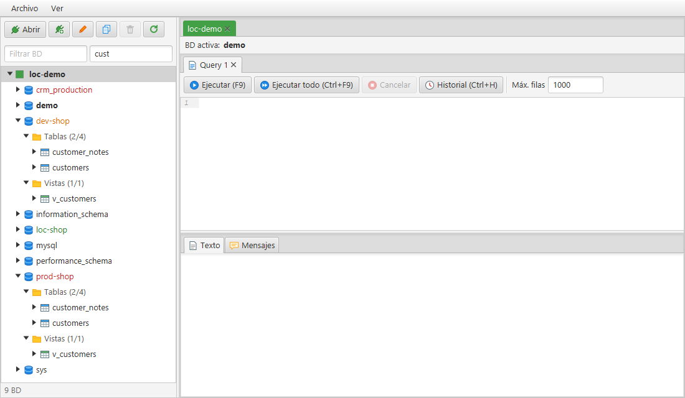
23. **0.22.0** — **copiar BD o tablas a otro servidor o a otra BD** (el "Copy Database To Different Host/Database" de
    SQLyog), con clic derecho en una BD ("Copiar BD a otro servidor/BD...") o en una tabla ("Copiar tabla..."). Se
    marcan los objetos (tablas, vistas, procedimientos, funciones, triggers y eventos), se elige la conexión y la BD
    destino (si no existe se crea, con el juego de caracteres del origen) y las opciones: estructura y datos o solo
    estructura, borrar en destino si existe, INSERT en bloque, ignorar DEFINER y copiar los triggers de las tablas
    marcadas. Entre MySQL/MariaDB, por cualquier vía (directa, SSH o túnel HTTP, también como origen). Corre en segundo
    plano con barra de progreso y botón Parar; al acabar, un resumen por objeto (se abre solo si hubo errores). Un
    destino de producción pide confirmación y copiar una BD sobre sí misma (aunque sea por otra conexión al mismo
    servidor) se rechaza.

    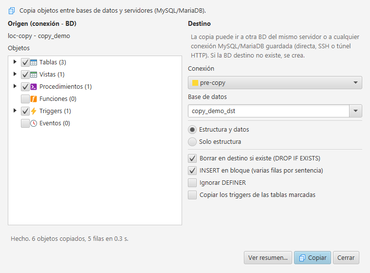
24. **0.23.0** — la rejilla **ordena por columna** con clic en la cabecera (ascendente, descendente, sin ordenar, como
    SQLyog): NULL primero y los números por su valor. **Ejecutar** pasa a **Ctrl+Enter** (F9 sigue valiendo). En la
    copia, la BD de origen sale en azul y no se ofrece como destino en la misma conexión.
25. **0.24.0** — **menú contextual de la rejilla** como el de SQLyog: insertar fila, guardar, borrar, cancelar cambios;
    poner cadena vacía, NULL o DEFAULT; quitar orden; **Filtro** por el valor de la celda (=, <>, LIKE, NOT LIKE, >, <;
    en la pestaña Datos va al WHERE); **Exportar las filas como...** CSV, JSON, XML, HTML o SQL (Ctrl+Shift+E);
    **Copiar** celdas, filas, todo con cabecera o el nombre de la columna; duplicar fila. Y el **logo** de la app,
    "1 gestor, n motores".
26. **0.25.0** — la rejilla lleva a la izquierda la **columna con el número de fila** (solo lectura, `*` en las filas
    nuevas) que hace de botón: clic elige la fila entera (Mayúsculas extiende, Ctrl añade o quita) y clic derecho da
    borrar, duplicar o copiar las filas. La **esquina** `#` elige todo lo que se ve y su clic derecho exporta como CSV,
    INSERTs, JSON, XML o HTML.
27. **0.26.0** — la app pasa a llamarse **multidbs** (ventana, cliente de las BD y exportes; los datos siguen en
    `~/.javayog`) y el **logo sale de verdad** en la barra de tareas y en la barra de título de todas las ventanas (antes
    salía el de Java).
28. **0.27.0** — **multi-idioma**: inglés, español, neerlandés y papiamento (de Curazao). Arranca en el idioma del
    sistema si está entre esos cuatro; si no, en inglés. Selector con **banderas** arriba a la derecha (se guarda y la
    ventana se vuelve a montar en el idioma nuevo). Traducciones estilo gettext: un `.po` por módulo e idioma en
    `src/modules/<módulo>/infrastructure/i18n/`; la clave es el texto tal como está en el código o el FXML (`%texto`).
29. **0.28.0** — **SQL Server** (motor `mssql`, puerto 1433): directo y por túnel SSH (el túnel PHP no lo habla). El
    árbol lista las BDs del servidor, como en MySQL; una tabla de `dbo` sale por su nombre y la de otro esquema como
    `esquema.tabla`. Info arma el DDL (columnas con `IDENTITY`, PK, UNIQUE, FK, CHECK e índices con `INCLUDE`), Datos
    usa `SELECT TOP n` y el editor trocea como SSMS: solo corta una línea `GO` (el `;` no).
30. **0.28.1** — el **SELECT en pestaña nueva** del árbol trae las columnas de la tabla, una por línea (como SQLyog),
    en vez de `SELECT *`; en SQL Server con `TOP n`.
31. **0.29.0** — **Duplicar tabla** en el menú del árbol: estructura y datos a `<tabla>_copy_<ymdhis>` en la misma BD
    (MySQL `CREATE TABLE ... LIKE`, PostgreSQL `LIKE ... INCLUDING ALL`, SQLite su DDL con el nombre nuevo, SQL Server
    `SELECT ... INTO` más la clave primaria). Si falla a medias, la copia se borra.
32. **0.30.0** — la columna 0 de la rejilla lleva **casillas** como SQLyog: cada clic añade o quita la fila de la
    selección (multiselección; con Mayúsculas, el rango) y la casilla del encabezado marca o desmarca todas (a medias si
    solo hay algunas). El número de fila sigue al lado.
33. **0.31.0** — diálogo **Exportar como** (Ctrl+Shift+E y la esquina de la rejilla), como el *Export As* de SQLyog:
    CSV, JSON, HTML, XML, **Excel XML** y SQL. Opciones de CSV (separador, comillas, escape, fin de línea y NULL con la
    notación `\t` `\n` `<NONE>`), de Excel (ancho máximo y decimales) y de SQL (tabla y filas por INSERT); cabecera
    opcional, **campos a exportar**, **todas las filas o solo las marcadas**, juego de caracteres (UTF-8 con BOM para
    Excel, ISO-8859-1, windows-1252...) y fichero. Recuerda lo elegido mientras la app sigue abierta. En el tema oscuro
    el botón por defecto ya se lee.
34. **0.32.0** — en el panel, cada conexión lleva un **enchufe** del color de su entorno (antes un cuadrado) y su
    **menú contextual**: abrir, editar, clonar, **renombrar**, eliminar y refrescar. Todo borrado (conexión, clave de
    Redis, documento de MongoDB) pregunta siempre, con **No** como botón por defecto, como SQLyog.
35. **0.32.1** — imports de todo el proyecto (118 ficheros) ordenados como manda la regla DDD: `shared`, transversales,
    módulos ajenos y el propio al final, con dominio → aplicación → infraestructura y la excepción cerrando el grupo.
36. **0.33.0** — **Duplicar tabla** pregunta el nombre (con `<tabla>_copy_<ymdhis>` ya escrito) y solo acepta letras,
    dígitos y `_` (sin espacios ni caracteres especiales; si no vale, avisa y vuelve a preguntar). Al acabar, el árbol
    queda **como estaba** (lo desplegado y la fila de arriba) con la copia elegida.
37. **0.34.0** — **Volcado SQL** (el *SQL Dump* de SQLyog, MySQL/MariaDB): BD, objetos marcables, solo estructura /
    solo datos / ambos, transacción única, `USE`, `CREATE DATABASE`, `FOREIGN_KEY_CHECKS=0`, INSERT en bloque, `DROP`,
    sin `DEFINER`, versión y fecha delante del nombre; se escribe según se lee (por páginas) y las vistas van en orden
    de dependencia. **Ejecutar fichero SQL** (importar, cualquier motor SQL): lee el `.sql` por trozos sin cargarlo en
    el editor (`DELIMITER`, `$$` y `GO` aunque caigan entre trozos), con progreso, Parar y "parar en el primer error";
    en producción pide confirmación. Desde el menú de la BD en el árbol y dos botones en la barra de la BD activa.
38. **0.35.0** — **Editar tabla** (el *Alter Table* de SQLyog, MySQL/MariaDB) desde el menú de la tabla, en pestañas:
    **Columnas** (nombre, tipo, longitud, DEFAULT, PK, NOT NULL, UNSIGNED, AUTO_INCREMENT, ZEROFILL, comentario;
    añadir, insertar, borrar, subir y bajar), **Índices**, **Claves foráneas**, **Avanzado** (motor, cotejamiento,
    comentario, AUTO_INCREMENT, formato de fila) y **SQL** con lo que se va a ejecutar. Se puede renombrar la tabla
    (mismas reglas de nombre que al duplicar). Solo se genera lo que cambia; en producción pide confirmación; al
    guardar, el árbol queda como estaba con la tabla elegida.
39. **0.36.0** — **estado de cada conexión** en el panel: abierta, con el enchufe en su color y el nombre en negrita;
    cerrada, con el enchufe apagado y "sin conexión" (también en el tooltip). Nueva opción **Desconectar** (menú de la
    conexión y botón de la barra): cierra su pestaña, sus sesiones y su árbol, igual que la X de la pestaña. Los
    botones del panel pasan a otra línea si no caben.
40. **0.36.1** — test del panel sin carrera: comprobaba los hijos de la conexión antes de que se desconectara.
